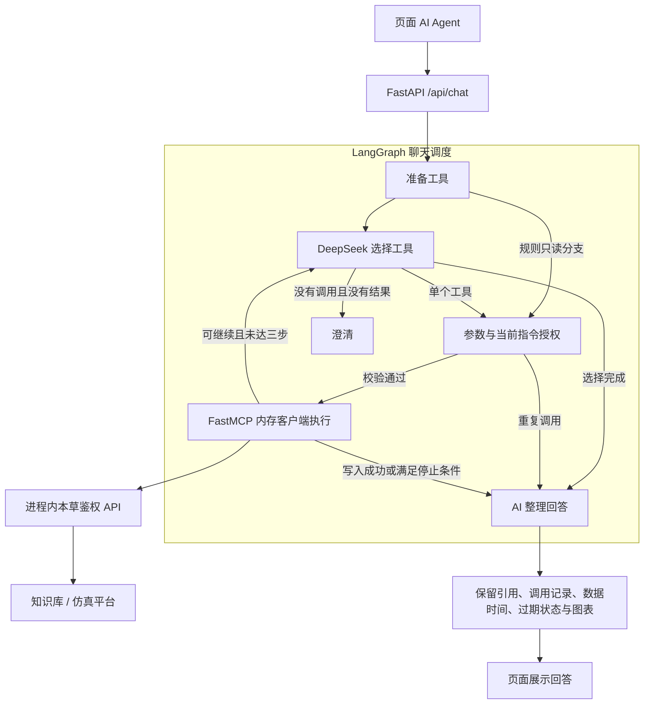

# 五模块 MCP 与 AI Agent

2026-11-19。聊天工具调度使用 `langgraph==1.2.18` 的状态图，五个模块使用独立包 `fastmcp==4.2.2` 封装为标准 MCP 工具，仅供页面 AI Agent 通过 FastMCP 内存客户端调用。工具沿用当前登录会话，通过进程内 API 访问知识库和仿真平台，不直接读取另一个项目的数据库。

## 工具

| 工具名 | 对应模块 | 参数与能力 |
| --- | --- | --- |
| `herbal_reference` | 中药基础资料 | `action=read` 按 block 分页阅读（offset/limit）；`search` 按 query 检索内置原文；`ask` 按 query 运行原有知识库回答，保留原文引用及最多5轮 history。read/search 无需模型，ask 复用原 RAG / DeepSeek。 |
| `data_center` | 数据中心 | `snapshot` 读取设备/报警快照；`question` 回答既有设备、锅号与利用率问题；`statistics` 按 days=1/7/30 或成对 start_date/end_date 统计；`prescriptions` 按 status/offset/limit 分页；`batch` 按 batch_id 读取详情。 |
| `operations_overview` | 运行总览 | 返回共享快照的时钟状态、累计指标、批次分布及设备分类数量/状态；可传 refresh。 |
| `test_execution` | 测试执行 | `running` 只列进行中批次与使用中设备；`completed` 完成批次分页；`progress` 按 limit=1..20 读取最近批次工序、等待原因及实际处理/配置秒数，通常读5条；`status` 直接读取启停状态；`create` 生成 count=1..50 个匿名演示批次；`start/pause` 启停当前仿真。 |
| `test_plans` | 测试方案 | `read` 读取13类设备默认用时和 revision；`save` 保存 kind、minutes=0.1..120、expected_revision。药锅 pot 没有固定用时。 |

完整 schema 由 MCP `tools/list` 返回，禁止额外字段。数据读取保留 `fetched_at` / `synced_at`、`stale`、`error`、空数据和历史缺口；refresh 只通知共享快照刷新，不代表远程刷新已经完成。保存用时仍只影响后续数据，处方显式工艺参数优先，已有批次不重算。未实现测试判定、报告导出、单任务停止或物理设备控制。

## 页面 AI Agent

安装更新后的后端依赖并重启后端；前端无需重新构建。仍使用已有 DeepSeek 配置，模型/网关须支持 Tool Calls。已配置模型时所有Agent问题统一先做语义工具选择，不再由关键词决定是否进入模型，也不再默认回退药材检索。运行数据无需知识库原文；只有药材/方剂知识问题选择资料工具。模型或平台失败返回实际错误；意图不清时澄清，不伪装成资料未命中。没有模型配置时，仅既有规则明确识别的运行查询可继续只读，其他Agent问题返回503。

可直接发送：

- `陈皮的功效`：中药基础资料，保留原文引用。
- `我现在工作有几个锅`：语义选择数据中心工具，工具内复用既有设备数量规则。
- `帮我看看最近几个方子用时，都卡在哪一步`、`这几张单怎么还没好`、`最近的处方做到哪了`：选择测试执行的progress，读取平台批次工序，不查询知识库原文。
- `查看运行总览`、`数据中心近7天统计`、`查看已完成的历史批次`。
- `生成2个仿真演示批次`、`开始仿真`、`暂停仿真`。
- `帮我下3个测试任务`、`下发三个任务`、`安排3项测试作业`：测试任务对应仿真演示批次，按明确数量创建，不自动开始仿真。
- `下3个测试方子`、`下三份测试处方`、`下发两张模拟药方`：测试/仿真/模拟/演示限定的方子、处方、药方同样指匿名演示批次。写入须通过独立的当前指令与数量核对；普通方子不能授予批次创建权限。查询方子时按上下文选择运行数据或方剂知识，不由“方子”一词强制查原文。
- `查看测试方案的默认用时`、`把包装默认用时改成2分钟`。

回答说明已调用的 MCP 模块；接口额外返回 `toolCalls: [{name, title, action}]`。工具选择最多3步、每步1个调用，修改成功后不再执行工具。随后由 DeepSeek 根据本轮已校验结果整理正文：先回答问题，再组织相关细节。后端保留原文引用、真实调用记录、数据读取时间、过期提示、数据中心入口及图表，模型不能改写这些字段。药材 ask 已经过 AI 生成及来源校验，直接复用；未配置模型时规则只读查询直接返回工具结果。普通 AI 兼容模式 `use_knowledge=false` 不调用这些工具。

用户已明确同意将本轮设备、批次、统计等结果发送到当前配置的 DeepSeek 服务。整理只接收当前问题及工具结果的标题、说明和正文，不发送登录 Cookie、凭据或旧轮回答；使用已有 JSON Output 客户端，单次最多30秒，不带工具定义、不执行操作。仅接受1–8节的正文结构，拒绝新增数字 / 设备编号与伪造文档引用；这不能替代完整语义事实核验。输入超过48000字符、模型超时 / 失败或输出不合法时，返回已有工具结果并明确提示，不重试模型或业务写入。工具选择失败与工具执行失败仍直接返回实际错误。Token 用量继续仅统计工具选择，不包含本次整理。

progress读取后先按校验字段计算实际处理分钟数，再交给 AI 按当前问题整理，不能新增耗时或故障推断。最近记录从平台完整分页集合按created_at、sequence倒序选取；一次最多核验1000条，分页变化/重复或超过范围时明确失败，不把首屏旧记录冒称最近。缺少创建时间时说明无法确认最近顺序。实际处理用时为工序elapsed_seconds累计值，不含排队/暂停，当前工序duration_seconds为该批次配置值；缺少实际计时不按零或默认值填补，未提供等待起止时不能判断等了多久或长期卡死。

页面写入只接受当前问题中明确的一项操作及其参数。生成数量支持阿拉伯数字、全角数字及常用中文数字（含两、十、二十等），仍须为1–50的确定整数；修改分钟数使用阿拉伯数字。保存须明确一个设备种类，并在本轮先读取可写版本。否定、假设、询问操作方法、参数不一致或陈旧修订号不会触发修改。含多项修改的需求请分轮发送。模型不支持工具、无有效参数或缺少信息时返回实际错误/澄清；资料、历史或工具文本不能授权写入。

测试方子识别的截图原话、普通处方边界和真实模型页面验收见 [专项验证](MCP-TEST-PRESCRIPTION-QA.md)。

最新统一语义调度与运行工序查询验收见 [运行查询验证](MCP-SEMANTIC-ROUTING-QA.md)，替代此前以关键词决定是否调用Agent的行为说明。

## 运行与调用链

安装依赖后，按 [开发说明](DEVELOPMENT.md) 启动本草前后端并登录，即可使用页面 AI Agent；无需另设 MCP 账号或启动进程。在项目根目录安装后端依赖：

```powershell
.\backend\.venv\Scripts\python.exe -m pip install -r backend/requirements.txt
```



`answer_with_mcp` 保留 `Client(server, timeout=190)` 的生命周期，再通过 LangGraph 的 `ainvoke` 执行 prepare_tools → select_tool → authorize_tool → execute_tool → format_answer / clarify，条件边决定继续或结束。工具发现使用 `list_tools()`，DeepSeek Tool Calls 提供选择，执行使用 `call_tool(..., raise_on_error=False)` 并检查 `is_error / structured_content`。业务上限为三次模型选择，图递归上限16；重复调用直接整理已有结果，知识回答、工序进度、过期结果和成功写入均会停止。节点异常直接结束并交由原 API 错误处理返回，不配置节点重试或失败后的知识库回退。

图实例可复用，每轮的消息、结果、用量与已读取修订号均为独立状态。当前 FastMCP 客户端、配置和服务函数通过 runtime context 传入，不放入图状态；不设置 checkpointer / store，远程 LangSmith 追踪关闭。`create_server` 继续以自定义 `Tool` 保留扁平 schema、严格 Pydantic 校验与脱敏错误；`BencaoClient` 使用当前会话 Cookie，通过 `httpx.ASGITransport` 访问同一 FastAPI 应用，不自行登录或重试操作。

图中的「AI 整理回答」对应异步 `format_answer`：运行类结果由 `synthesis.py` 调用 DeepSeek 整理；知识 ask 复用已生成正文，无模型规则分支直接保留原结果；整理失败也走保留结果的路径，均不会返回执行工具节点。

写入的 `confirmed=true` 由后端校验当前用户明确指令后生成；保存设备用时须在本轮先读到当前可写修订号。业务 API 继续逐请求校验登录及权限，保留 CSRF、版本冲突、并发锁、平台回执确认与单次发送。

超时/连接中断可能已触及平台，先读取实际状态，不能自动重发；`isError=true` 不等于修改一定没有生效。测试方案保存冲突后重新读取并核对，不自动覆盖。

## 实现与验证

- `backend/app/mcp_tools/workflow.py`：聊天 LangGraph 状态、节点、条件边与请求级上下文；`agent.py` 保留模型请求、授权规则、格式化和 HTTP 生命周期。
- `backend/app/mcp_tools/synthesis.py`：本轮工具结果的 AI 正文整理、结构与新增数字 / 编号检测、失败保留；JSON Output 配置复用既有客户端，参见 [DeepSeek JSON Output](https://api-docs.deepseek.com/guides/json_mode/)。
- `backend/app/mcp_tools/` 其余模块：严格输入模型、五工具注册、当前会话 API 适配及结果展示。
- `POST /api/knowledge/query`：复用原知识库流程，避免 MCP 回调 `/api/chat` 递归。
- `POST /api/data-center/question`：复用既有规则运行问答。两个接口均保留登录、knowledge:read、CSRF、64 KiB 请求上限及脱敏校验错误。
- 直接依赖固定为 `fastmcp==4.2.2`；`mcp==2.3.0`、`mcp-types==2.3.0` 等底层传递依赖统一固定在锁文件，业务代码不再使用低层 SDK 接口。迁移依据见 [FastMCP 迁移说明](https://gofastmcp.com/docs/getting-started/upgrading/from-low-level-sdk-v1)、[FastMCP 内存客户端](https://gofastmcp.com/docs/clients/client)、[工具结果与错误](https://gofastmcp.com/docs/clients/tools) 和 [DeepSeek Tool Calls](https://api-docs.deepseek.com/guides/tool_calls/)。
- 聊天图复用已有 `langgraph==1.2.18`，图与运行时上下文依据见 [LangGraph Graph API](https://docs.langchain.com/oss/python/langgraph/graph-api) 和 [Runtime context](https://reference.langchain.com/python/langgraph/runtime/Runtime)。处方检查 Agent 保持原有独立 LangGraph 流程。

自动测试命令（backend 目录）：

```powershell
.\.venv\Scripts\python.exe -m unittest discover -s tests -p 'test_mcp*.py' -v
.\.venv\Scripts\python.exe -m unittest discover -s tests -v
.\.venv\Scripts\python.exe -m pip check
```

验收范围及实际结果见 [MCP 验收](MCP-TOOLS-QA.md)。
