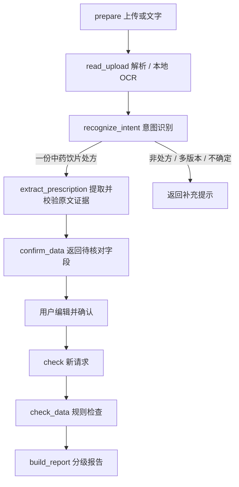

# 处方检查 Agent

更新与验收：2026-10-28。

## 使用

打开 [本地应用](http://127.0.0.1:3000)，登录后点击侧栏「处方检查」。右上角「知识库资料」仅管理共享资料，抽屉中的重复处方入口已移除。

1. 上传一份处方文件或图片，也可粘贴文字；没有配置 AI 时可直接手动录入。支持 TXT / MD / DOCX / PDF / PNG / JPG / WEBP，单文件 10 MB，文字 2 万字符，PDF 1–8 页。
2. 系统识别是否为单一中药饮片处方，再提取字段。非处方、含多个版本、无法确定的输入会要求补充；不会把教学介绍当作待审核处方。核对页提供原图、识别原文和可编辑药物明细。
3. 逐项核对药名、数字、小数点、单位、煎法和每剂量口径，勾选确认后检查。修改字段会清除勾选；报告可复制、修改后复查。检查另一份会立即清空上一份的数据与图片。

按用户明确要求，当前应用默认「每一剂的量」。上传与核对页显示「本方剂量口径」，支持每剂量、总量、逐味设置：整方选择会随 prepare、人工核对、check、报告完整传递；后台在运行规则前统一各味口径，返回实际检查的处方快照。新增药行继承本方选择，改动不换算数值 / 单位，不根据总剂数相除。单味改成其他口径会自动切换逐味模式，后台保留各行口径和真正未知项。新处方清空旧数据并重置为明确显示的每剂量默认；仍须对照原文核对并勾选确认。

报告仅按用户提供的审核意见格式展示五节：3.1 审核结论、3.2 主要问题、3.3 毒性药材与煎法核查、3.4 其他核查、3.5 处理建议。结论和建议前缀加粗，正文采用项目符号，处理建议带编号与子项。复制为相同 Markdown 正文；原来的卡片、计数、明细折叠、版本 / 范围面板和报告内批量口径按钮已移除。需要改口径时通过底部「修改数据后复查」回到核对页。关键信息不完整时，3.1 下直接显示具体需补充清单和「去补充信息」；点击保留已有值并聚焦首个缺失字段，补齐后重新确认检查，清单随报告更新。复制包含相同清单。

主要问题标题使用当前原始药名；剂量及煎法只引用本次已确认记录，未核实的十九畏、炮制、实际煎煮及机构要求不写为「未发现 / 符合要求」。不能确认现行药典全文的条目改用已核验的公开用药资料并附内联来源，不把公开参考范围冒称完整现行药典。替代饮片与加减量由医师决定，系统不自动改方。

本次报告格式及边界见[分节报告验收](PRESCRIPTION-REPORT-QA.md)。3.1 由系统给出明确的通过 / 不通过 / 待补充信息，并写明判断依据。通过限定为本次已覆盖项目的系统辅助审核，实际专业核对要求保留在 3.5 正文。

## 实际流程

后端使用 LangGraph 1.2.18 的 StateGraph，完成编译后执行条件路由。人工确认采用两阶段请求，不在服务端保留病例检查点。

读取与提取分层：RapidOCR 在本地 CPU 处理图片和扫描 PDF，PDFium 读取文本 / 渲染页面，python-docx 按原顺序读取正文和表格。DOCX 内嵌图片不作为文字解析，并向用户提示单独上传。所有原文和药物字段均有限长边界；模型提取的药名、剂量和单位须能对应所给原文，不能补造来源。

DeepSeek 只承担意图与结构化提取；规则检查以确认后的数据执行，不由模型决定审核通过，不自动生成替代处方。意图阶段展示输入类型说明，不提前显示模型的用药判断。

## 已接入规则与边界

- 基本信息缺失：年龄、性别、诊断、过敏史、服法、总剂数，以及应核实的妊娠状态；「未提供 / 未知」不视为已补齐。
- 药物数据：缺失药名 / 剂量 / 单位、非正数或无效数字、未知单位、重复药材与登记的炮制别名。不会把白附子归为附子，不进行片、枚、钱等单位到克的猜测转换。
- 有限配伍规则：已登记的乌头类与半夏等、甘草与甘遂等、藜芦与参芍等十八反组合，以及人参—五灵脂十九畏组合。毒性饮片和妊娠等情况单列复核项，不把未命中当作排除风险。
- 参考剂量：仅对可用成人条件、已确认每剂量且可换算 g / mg 的条目，与本地基础文档所列范围比较；重复行合计后比较。总量、口径未知和儿童剂量不套用成人参考范围。此范围不冒充完整现行药典。
- 部分特殊煎法：例如砂仁后下信息未明确时提示复核；不验证实际炮制、煎煮过程。

尚未覆盖完整现行药典、全部十九畏与妊娠禁忌、西药相互作用、诊断适宜性、医师授权和签章。手写、低清和复杂表格识别可能有误，需要人工核对。

## 依据与数据处理

规则版本：`2026-10-28.7`。规则来源固定在服务端，上传内容不能改写检查规则。已确认总量提示人工复核，口径未知才标为信息缺失；历史验收截图可能显示前一规则版本。

- [《医院中药饮片管理规范（2026版）》官方转载](https://wsjk.ln.gov.cn/wsjk/zfxxgk/zc/gjjwj/2026042809553322479/index.shtml)：审核与管理范围依据。
- [香港卫生署：安全使用含乌头类生物碱中药材](https://www.cmro.gov.hk/html/b5/useful_information/public_health/exhibit_boards/The_Safe_Use_of_Chinese_Medicines_Containing_Aconitum_Alkaloids.html)、[生半夏和制半夏](https://www.cmro.gov.hk/html/b5/useful_information/public_health/publication/AdverseEvents7.html)：相关用药复核提示。
- 项目登录后可下载的《中药基础知识（详解版）》：有限配伍、参考剂量和特殊煎法依据；不是完整现行药典数据库。
- [LangGraph Graph API 官方文档](https://docs.langchain.com/oss/python/langgraph/graph-api)、[RapidOCR 官方仓库](https://github.com/RapidAI/RapidOCR)、[PDFium Python API](https://pypdfium2.readthedocs.io/en/stable/python_api.html)：实现接口依据。

所有接口需登录，写接口沿用 CSRF / Origin 校验；三种角色均能使用个人处方流程。处方文件、结果不写入共享 documents 或 SQLite，不启用持久检查点；该流程禁用远程 tracing。请求解析可能使用临时缓冲，处理后关闭文件，未建立原文件库或报告历史。

识别文字发送给既有 DeepSeek 服务；原图片不发送到图片云服务。基础遮盖会处理明显姓名 / 电话 / 证件等，但不保证完整匿名化，请先脱敏。关闭弹窗会终止浏览器等待，已经发出的后端调用可能继续完成。

## 验收

- 依赖安装与 `pip check` 通过，NumPy 固定为同时支持 Python 3.11+ 与本机 Python 3.14 的 2.3.5；本轮未逐一运行其他 Python / 操作系统版本。
- `pnpm typecheck`、前端 22 项回归、后端 72 项回归通过，其中处方新增 19 项。覆盖 LangGraph 意图分支、确认边界、权限、上传限制、Word 顺序、扫描 PDF 渲染、原文证据、负数剂量、重复、未知药名、单位和参考剂量边界。
- 最终独立源码副本 `next build --webpack` 成功。真实 Next.js 3110 → FastAPI 8110 代理、临时 SQLite、随机测试账号，使用虚构处方；没有模拟业务 API 响应。
- 文本、DOCX、PNG 与扫描 PDF 的本地读取 + 真实 DeepSeek 意图 / 提取均进入待确认步骤。图片测试暴露了数字识别差异，按设计对照原图人工修正后再检查；未将 OCR 置信度当作正确率保证。
- 浏览器完成：抽屉与侧栏入口、Tab 循环 / Escape、问答草稿保留、原图对照、确认前禁止检查、修改后重新确认、真实规则报告、复制、改后复查、下一份清除旧数据、非处方拦截、390 / 320px 手动录入及报告，原有原文检索继续可用。处方未出现在共享资料中。
- 无页面异常或业务 API 5xx。此前验收脚本对装饰 SVG 和未实际修改的字段断言不当，已修正；实际发现的新处方旧预览清除时序问题已修复并通过最终验收。

证据：[结构化结果](../design/prescription-agent-qa/result.json)、[四种文件真实识别记录](../design/prescription-agent-qa/file-flows.json)、[桌面上传](../design/prescription-agent-qa/desktop-upload.png)、[原图核对](../design/prescription-agent-qa/desktop-image-confirm.png)、[编辑确认](../design/prescription-agent-qa/desktop-fields-confirm.png)、[报告](../design/prescription-agent-qa/desktop-report.png)、[320px 报告](../design/prescription-agent-qa/mobile-320-report.png)。上述截图已目视核验。

本机服务已加载新接口：前端 3000 与后端 8000 健康检查返回 200；新处方接口出现在后端 OpenAPI，未登录经前端代理访问返回预期 401。

### 历史：当前处方统一每剂量（已由整方选择替代）

2026-10-28：新增「全部设为每剂量」。类型检查、22 项前端回归及独立生产构建通过；Edge 在临时账号和真实 Next.js → FastAPI 代理下验证：键盘可触发批量设置，药名、剂量、单位与煎法不变，原勾选确认失效；实际报告移除对应剂量口径提醒，仍可逐味改回总量或未知。390 / 320px 按钮可见且不少于 40px 高；新处方保留未知默认，不继承上一次口径，空药物表不可批量设置。未新增模型请求。

证据：[结果](../design/prescription-dose-scope-qa/result.json)、[桌面](../design/prescription-dose-scope-qa/desktop-bulk-per-dose.png)、[320px](../design/prescription-dose-scope-qa/mobile-320-bulk-per-dose.png)，两张界面截图已打开核验。

功能已达到本轮接入范围；完整临床审方规则、机构级药典库与手写识别专项评测仍待后续接入。

### 报告直接确认口径与快照更新

2026-10-28：规则更新为 .2，已确认总量使用 `dose_total_review / review`，只有未知口径使用 `dose_scope / missing`。报告顶部显示当前尚未按每剂量检查的数量，提供「确认全部为每剂量并重查」；以当前报告的完整处方快照统一口径后发送新请求，数值、单位与其他字段不变。只有后端成功返回才替换旧报告，显示「本次检查口径：全部为每剂量」。重查期间复制、切换处方和修改操作不可用；其他真实缺失信息不会被隐藏。

类型检查、22 项前端回归、72 项完整后端回归和最终生产构建通过。真实生产代理 Next.js 3112 → FastAPI 8112、临时账号和虚构处方验证：先复现 3 条口径提醒，再从报告直接确认并重查；实际请求携带全部 `per_dose`，返回不含剂量口径提醒，保留真实过敏史缺失项。延迟真实请求时操作锁定正确，390 / 320px 均可从报告直接完成重查并保留编辑数据。没有调用模型或伪造 API 响应；本机后端已重启加载新规则。

证据：[结果](../design/prescription-report-scope-qa/result.json)、[重查后桌面](../design/prescription-report-scope-qa/desktop-scope-rechecked.png)、[320px 直接重查](../design/prescription-report-scope-qa/mobile-320-scope-pending.png)，两张截图已打开核验。

### 每剂量确认贯穿整个流程（规则 .3）

2026-10-28：前述按钮仅修改手动点选后的数据，没有处理上传提取仍返回未知、新增行仍回到未知的根因。现在按用户已明确的要求默认每剂量，整方选择作为独立字段随 prepare 传递，在提取后应用；check 在运行规则前再次统一各行，报告返回同一实际快照。新增行继承本方口径，逐味修改自动切换逐味模式。省略整方字段的旧 API 客户端保留逐行语义；浏览器仍打开的旧格式报告会按用户确认的每剂量自动重查，成功后更新快照。数值、单位与总剂数不被换算。

同时修复姓名脱敏将「患者：姓名，男，58 岁」整行遮盖导致年龄和性别误报缺失的问题：只保留明示的性别和年龄片段，不从姓名猜测。真实未提供的过敏史等仍按规则提示。

验证：前端类型检查、22 项回归、独立生产构建与完整后端 76 项通过。本次新增 3 项接口回归及 1 项脱敏回归。Edge 使用临时账号、真实 Next.js 3113 → FastAPI 8113 代理，将用户虚构样例的基本信息和「修改前」单份处方发给实际 DeepSeek 识别；10 味药数字和单位保持原值，全部为每剂量，年龄 58 / 男保留，实际报告信息缺失为 0，配伍和高风险饮片复核项仍存在。手动输入与新增行默认、总量模式、单味未知保留、390 / 320px 均通过。旧报告兼容测试使用明确的旧响应格式适配器，真实后端先生成未知口径报告，再由界面自动调用后端重查；其他业务响应未模拟。本机 3000 / 8000 服务健康，新接口字段已加载。

证据：[结果](../design/prescription-scope-flow-qa/result.json)、[用户虚构示例真实提取及报告](../design/prescription-scope-flow-qa/example-flow.json)、[桌面报告](../design/prescription-scope-flow-qa/desktop-example-report.png)、[320px 默认口径](../design/prescription-scope-flow-qa/mobile-320-default-scope.png)、[320px 报告](../design/prescription-scope-flow-qa/mobile-320-report.png)。桌面报告与 320px 界面均已打开目视核验。前文各阶段记录属于历史行为，以此节和「使用」为当前行为。

### 历史：审核结论（规则 .4，版式已由五节正文替代）

2026-10-28：报告标题下方新增「审核结论」，由 `review.py` 根据同一份服务端 findings 生成，API、页面与复制保持一致。命中已登记十八反规则时优先显示用户指定原文：

> **不通过。** 处方存在“十八反”配伍禁忌，建议暂缓调配，联系处方医师确认或修改。

其他数据异常同样不通过，但不冒称十八反；信息缺失为待补充、其他用药或数据问题为待药师复核、无命中仅为已覆盖规则未发现问题。系统辅助结论需药师复核确认，不伪造药师签名、审批或临床放行。报告中的问题明细、依据及范围继续保留。

依据沿用前述规则来源，并复核 [香港卫生署生半夏和制半夏用药注意](https://www.cmro.gov.hk/html/b5/useful_information/public_health/publication/AdverseEvents7.html) 的乌头类同用限制，以及 [2026 版医院中药饮片管理规范](https://wsjk.ln.gov.cn/wsjk/zfxxgk/zc/gjjwj/2026042809553322479/index.shtml) 的专业人员审核要求。结论不增加新配伍范围，也不由上传文字或模型生成任意结论。

验证：完整后端 79 项通过（本次新增 3 项，覆盖规则优先级、三类已登记十八反组合、改后重算、普通复核不冒称十八反、异常与缺失分支）；前端类型检查、22 项回归和最终独立 `next build --webpack` 通过。Edge 真实生产代理 Next.js 3114 → FastAPI 8114，临时账号录入用户虚构 10 味药示例，验证结论原文、加粗显示与剪贴板一致；修改处方后原结论消失并重新计算。390 / 320px 均无横向溢出，截图已目视核验。使用一个明确的旧响应适配器测试缺失结论时保留数据并报错、恢复后可重试；其余业务响应未模拟，本轮未调用模型。

初次复制验收脚本将换行误写为字面转义字符串，并未等待复制完成；已修正脚本，复用未改动生产构建后最终全部通过。本地后端已重启加载 .4，前端 3000 与后端 8000 健康检查成功。

证据：[验收结果](../design/prescription-review-qa/result.json)、[用户示例实际报告](../design/prescription-review-qa/example-report.json)、[桌面结论](../design/prescription-review-qa/desktop-not-passed.png)、[320px 结论](../design/prescription-review-qa/mobile-320-not-passed.png)、[修改后结论](../design/prescription-review-qa/desktop-edited-conclusion.png)。

### 当前：五节审核正文（规则 .5）

用户要求用 3.1—3.5 审核意见替换旧格式。页面、复制和修改复查已改为同一五节结构，旧计数与卡片等已移除；验证及实际报告见[分节报告验收](PRESCRIPTION-REPORT-QA.md)。完整后端 83 项、前端 22 项与类型检查、最终生产构建及桌面 / 手机流程均通过。

### 当前：直接列出需补充信息（规则 .6）

3.1 下新增本次具体缺失项与返回补充入口，复制同步，补齐重查后更新；实际配伍风险结论不因资料补齐而消失。完整后端 87 项、前端 22 项及类型检查、生产构建与桌面 / 手机流程通过，见[具体提示验收](PRESCRIPTION-REPORT-QA.md#具体补充信息提示6)。

### 当前：系统直接给出明确结论（规则 .7）

3.1 直接给出通过 / 不通过 / 待补充信息及实际判断依据；通过限定于系统覆盖项目。新增人参—五灵脂十九畏及用户提供的剂量 / 煎法核查，实际用药提醒与阻断项区分。当前规则及来源、完整示例结果和边界见[直接判定验收](PRESCRIPTION-DECISION-QA.md)，本节及「使用」优先于前述历史版本的结论行为。
